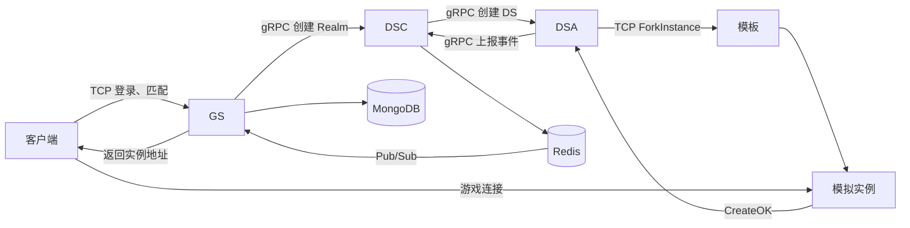

# 项目架构与核心概念

记录日期：2026-11-23。源码基线：`b0332a8a8bee9572d673acf1923d1042fe74c41d`。
本文由源码阅读整理，尚未完成运行验证。“自己的理解”是供学习者核对和改写的初稿。

## 阅读导航

1. [项目架构](01-项目架构.md)
2. [创建对局流程](02-创建对局流程.md)
3. [状态与 Redis 键](03-状态与Redis键.md)
4. [问题与验证记录](04-问题与验证记录.md)
5. [UE 接入计划](05-UE接入计划.md)

已有的架构 HTML 和图片继续保留，本组笔记用于补充源码依据和验证记录。

## 源码事实

| 模块 | 职责 | 阅读入口与关键函数 |
| --- | --- | --- |
| GS | 玩家连接、登录、匹配与对局地址通知 | [gameserver/main.go](../dsserver/gameserver/main.go) 的 `main`；[msgcb.go](../dsserver/gameserver/gameplayer/msgcb.go) 的 `ProcGameMsg` |
| Team | 管理匹配队伍，将队伍转为 Realm | [team.go](../dsserver/gameserver/team/team.go) 的 `QuickJoinRealmTeam`、`UpdateTimeoutTeam`、`convertTeamToRealm` |
| Realm | 请求 DSC 创建对局，接收 ready/fail 通知 | [realm.go](../dsserver/gameserver/realm/realm.go) 的 `CreateRealmAndWatch`；[watch.go](../dsserver/gameserver/realm/watch.go) 的 `subscribeLoop` |
| DSC | 抢占分配权、预占 Agent 容量、分配实例 | [gamedsc.go](../dsserver/dscserver/gamedsc/gamedsc.go) 的 `CreateRealm`、`allocateDS` |
| DSA | 管理本地实例和端口，向模板发送创建请求 | [agentserver.go](../dsserver/dsaserver/dsa/agentserver.go) 的 `CreateDS`；[dsmgr.go](../dsserver/dsaserver/dsa/dsmgr.go) 的 `NewDS` |
| dstemplate | 模拟模板与对局实例，监听 TCP 游戏端口 | [dstemplate/main.go](../dsserver/dstemplate/main.go) 的 `handleFork`、`instanceCtx.start` |
| 存储 | Redis 控制状态；MongoDB 用户和玩家数据 | [store/dsastore/store.go](../dsserver/store/dsastore/store.go)；[playermodel.go](../dsserver/gameserver/playermodel/playermodel.go) 的 `CreateUserPlayer` |

### 四个核心对象

| 对象 | 表示什么 | 标识与主要状态 |
| --- | --- | --- |
| Team | 等待组队完成的玩家集合 | TeamID；matching/closed |
| Realm | 逻辑对局及其成员关系 | RealmID；creating/ready/ingame/fail/ended |
| DS | 承载对局的运行实例 | DSID；creating/ready/playing/ended/dead |
| Agent | 管理某节点实例的代理 | AgentID；online/offline、容量、模板就绪状态 |

依据：[TeamInfo](../dsserver/gameserver/team/team.go)、[状态常量](../dsserver/store/dsastore/keys.go)、[AgentInfo/DSInfo/RealmInfo](../dsserver/store/dsastore/store.go)。

### 当前实现边界

- `dstemplate` 没有创建真正的 UE 子进程；其模拟实例在同一 Go 进程中监听 TCP 端口。
- `DSRuntime=process/container` 会作为运行类型信息上报，并配合不同部署配置；它本身不是完整的容器创建或 UE Fork 引擎。
- 玩家请求使用 TCP 消息编号和 Protobuf；服务间通过 gRPC 通信。
- MongoDB 中的玩家数据与 Redis 中的临时对局控制状态分开保存。

## 自己的理解（待核对）

- GS 决定“哪些玩家需要一局”；DSC 决定“分给哪个 Agent”；DSA 负责“在节点上请求创建和回收”。
- Realm 与 DS 分离后，逻辑对局可以先存在，随后才绑定运行实例。
- `CreateDS` 成功只代表创建请求已受理；实例自行上报 `CreateOK` 才进入就绪阶段。

## 待验证问题

- [ ] 用自己的话说明 Team、Realm、DS 的区别，并各举一个失败场景。
- [ ] 启动模拟环境，按同一 RealmID/DSID 串联 GS、DSC、DSA 日志。
- [ ] 确认客户端从自己的运行位置能够连接返回的实例地址。
- [ ] 结合实际日志，核对上图是否遗漏了状态更新或回收步骤。

## 本次学习记录模板

- 阅读日期与源码提交：
- 阅读文件与函数：
- 能确认的源码事实：
- 我的理解与理由：
- 不确定的地方：
- 下一步验证方法与结果：
