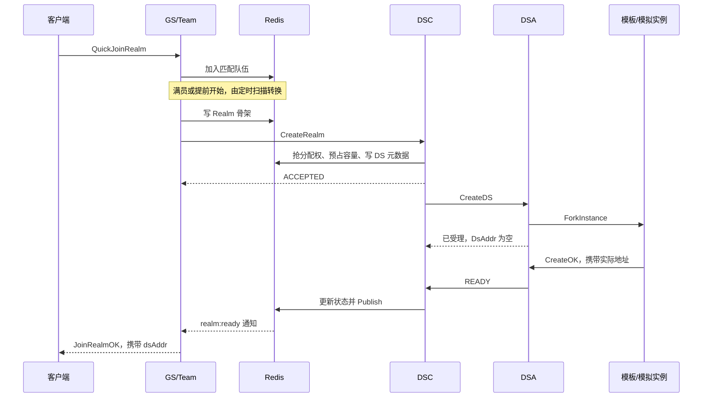

# 创建对局流程

记录日期：2026-11-23。源码基线：`b0332a8a8bee9572d673acf1923d1042fe74c41d`。
以下是源码中的预期流程，尚未证明当前版本可完整运行；已知阻断项见[问题记录](04-问题与验证记录.md)。

## 源码事实

| 步骤 | 文件与函数 | 主要行为 |
| --- | --- | --- |
| 1. 消息分发 | [msgcb.go](../dsserver/gameserver/gameplayer/msgcb.go) `OnMsgCB` → `ProcGameMsg` | 读取消息编号，查找连接对应的玩家，调用注册函数 |
| 2. 请求匹配 | [player_req.go](../dsserver/gameserver/gameplayer/player_req.go) `quickJoinRealmReq` | 解码 RealmConfigID，检查本地 TeamID，调用队伍模块，成功后保存 TeamID |
| 3. 查找队伍 | [team.go](../dsserver/gameserver/team/team.go) `QuickJoinRealmTeam` | 执行 Lua，加入同配置队伍或创建队伍；当前最大人数为 5 |
| 4. 触发开始 | 同文件 `StartRealm`、`UpdateTimeoutTeam` | 定时扫描到满员或 forceStart 队伍时进行转换；普通到期但未满员的队伍会解散 |
| 5. 生成 Realm | 同文件 `convertTeamToRealm` | Lua 抢占队伍转换权，移除旧队伍，生成 RealmID，调用 WriteRealmSkeleton |
| 6. 请求 DSC | [realm.go](../dsserver/gameserver/realm/realm.go) `CreateRealmAndWatch` | 先登记 watch，再调用 CreateRealm RPC |
| 7. 抢占分配权 | [gamedsc.go](../dsserver/dscserver/gamedsc/gamedsc.go) `CreateRealm` | 调用 TryClaimRealmAlloc；获胜者异步执行 allocateDS |
| 8. 预占节点容量 | 同文件 `allocateDS` | ReserveOptimalAgent → CreateDSMeta → 调用 DSA CreateDS |
| 9. 请求模板创建 | [agentserver.go](../dsserver/dsaserver/dsa/agentserver.go) `CreateDS` → [dsmgr.go](../dsserver/dsaserver/dsa/dsmgr.go) `NewDS` | 分配端口、登记 DS、发送 ForkInstance；RPC 返回成功时地址仍为空 |
| 10. 实例就绪 | [dstemplate/main.go](../dsserver/dstemplate/main.go) `instanceCtx.start` | 模拟实例先监听端口，再连接 DSA，发送 CreateOK |
| 11. 上报 DSC | [ds_msg.go](../dsserver/dsaserver/dsa/ds_msg.go) `dsCreateOK` | 绑定连接，处理 PendingStop，向 DSC 上报 READY |
| 12. 发布就绪通知 | [report.go](../dsserver/dscserver/dsareport/report.go) `ReportDSEvent` | 更新 DS，调用 MarkRealmReady 写 Realm 并发布通知 |
| 13. 通知玩家 | [watch.go](../dsserver/gameserver/realm/watch.go) `onRealmReady` → [realm_hook.go](../dsserver/gameserver/gameplayer/realm_hook.go) 回调 | 查对局和成员，将玩家更新与 JoinRealmOK 回包投递到 GS EventLoop |

`allocateDS` 是异步执行的，上图表示主要因果关系；ACCEPTED 响应与后台分配动作的具体交错不固定。

### 返回值与通知的区别

- player_req.go 中的 `return nil` 只是向调用者返回成功，不会自动生成网络响应。
- DSC 的 ACCEPTED 表示已接收；ALREADY_CREATING 表示已有创建；ALREADY_READY 可以返回已有地址。
- DSA 的 CreateDS OK 与实例 CreateOK 是两个不同阶段。
- 新实例的地址通常通过后续 JoinRealmOK 通知客户端。

### 失败与结束的入口

| 场景 | 阅读入口 | 需要核查的结果 |
| --- | --- | --- |
| 无可用 Agent | gamedsc.go `allocateDS` | Realm fail、分配标记释放、通知玩家 |
| 模板创建失败 | template_client.go `handleForkFailed` | 上报 DEAD、释放本地端口 |
| 创建后没有 CreateOK | dsmgr.go `SweepStaleCreating`；report.go `SweepOrphans` | 本地与 Redis 资源最终回收 |
| 创建中取消 | gamedsc.go `RemoveRealm`；agentserver.go `RemoveDS` | PendingStop 能处理迟到 CreateOK |
| 实例断连 | msgcb.go（DSA）`OnDisconnectCB` | 上报 DEAD、摘除实例、释放端口 |
| 对局结束 | ds_msg.go `dsGameEnd`；report.go `ReportDSEvent` | 清玩家映射、停止实例、释放容量 |

## 自己的理解（待核对）

整条链路是异步状态推进。判断成功需要同时观察客户端通知、Redis 状态和实例端口，不能只看某一次 RPC 返回 OK。

## 待验证问题

- [ ] 手动提前开始与满员开始是否都能走到 JoinRealmOK？
- [ ] 重复 CreateRealm 是否只产生一个 DS？
- [ ] RemoveRealm 与 CreateOK 同时发生时，实例和容量是否正确回收？
- [ ] 断开 Pub/Sub 期间实例就绪，在线玩家能否最终收到地址？

## 一次实验的记录模板

- 场景、日期、源码提交：
- UserID / TeamID / RealmID / DSID / AgentID：
- 各阶段日志及时间：
- Redis 前后值：
- 客户端收到的消息：
- 预期与实际差异：
- 结论与后续动作：
